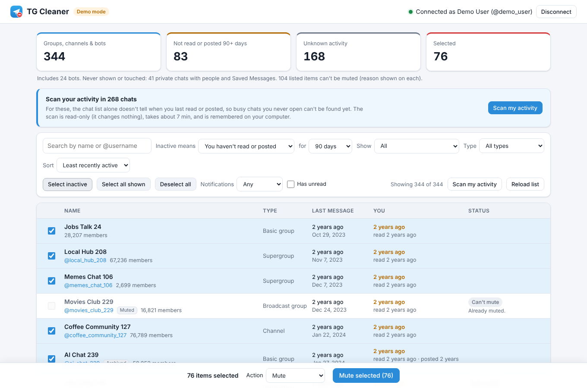

# TG Cleaner (personal)

A personal-use, all-in-one cleanup tool for your Telegram chat list. It finds dead groups, channels and bots, and busy chats you never actually read, then leaves, removes, archives or mutes the ones you pick, in bulk, with one confirmation.

- Connects to **your own** Telegram account (phone number + login code + optional two-step password).
- Lists your **groups, channels and bots**. For each: type, @username/link, your role, unread count, muted/archived, the last message in the chat, and **when you last read or posted there**.
- **Two ways to define "inactive"**, each with 7 / 30 / 90 / 180 / custom days:
  - *No new messages in the chat*: dead groups and channels, and bots you haven't used.
  - *You haven't read or posted*: chats that may be very active but that you never open.
- **Actions**: **Leave / remove** (leave groups and channels, delete bot chats, optionally block the bots), **Archive**, or **Mute** forever.
- Search, filters (type, muted, has unread), sorting, Select inactive, Select all shown, Deselect all, Shift+click ranges.
- Every action shows the exact names first, asks once, then runs one item at a time. You see Telegram's real answer for every item, and can retry the ones that can be retried.
- Runs entirely on your computer. There is no cloud backend, no account, and no analytics.
- Private chats with people and **Saved Messages are never listed or touched.**



---

## How it works

```
Chrome extension (dashboard tab)  ──HTTP, JSON──▶  Local service (Python)  ──MTProto──▶  Telegram
  UI only, no secrets              127.0.0.1:8765    Telethon + aiohttp
  stores only UI preferences                         keeps the session in ~/.tgcleaner/
```

* **Why a local service?** Leaving groups requires Telegram's client API (MTProto) as a *user*. The Bot API can't do it. A small Python service using [Telethon](https://docs.telethon.dev) is the simplest reliable way to do that. Keeping the session there also means no Telegram credentials ever exist in the extension or in Chrome storage.
* **Extension**: Manifest V3, plain HTML/CSS/JS, no build step, no frameworks. Clicking the toolbar icon opens the dashboard in a tab.
* **Service**: binds to `127.0.0.1` only. It accepts requests only from this extension's origin (see [Security](#security)).

Telegram operations used (checked against Telethon 1.45, API layer 229):

| Purpose | Telegram method |
|---|---|
| Send login code | `auth.sendCode` |
| Sign in / two-step verification | `auth.signIn`, then `account.getPassword` + `auth.checkPassword` (SRP; the password itself is never sent) |
| List groups, channels & bots | `messages.getDialogs` (all folders, including Archive) |
| Chat activity | date of each dialog's most recent message (comes with the list) |
| Your reading | unread count / read position from the list; if you're behind, `messages.getHistory(limit=1)` just below your read position gives the date of the newest message you've read |
| Your posting | `messages.search(from_id=you, limit=1)`: your newest message in that chat |
| Leave channel / supergroup | `channels.leaveChannel` |
| Leave basic group | `messages.deleteChatUser` with yourself as the user (your messages are **not** deleted) |
| Remove bot chat | `messages.deleteHistory(revoke=false)`: deletes your copy only; optional `contacts.block` |
| Archive | `folders.editPeerFolders` (folder 1 = Archive) |
| Mute | `account.updateNotifySettings` with "muted forever" |
| Disconnect | `auth.logOut`, then the local session file is deleted |

The service never calls Telethon's `delete_dialog()`, because that helper deletes private conversations when given a user. Chats with people are filtered out when the list is built, so no action can ever reach them. Chat history is deleted only for bots, and only when you confirm.

---

## Requirements

* Python **3.10+** (`python3 --version`; on Windows, install from python.org and tick "Add to PATH").
* Google Chrome (or another Chromium browser that supports Manifest V3).
* A Telegram **API ID** and **API hash** for your own account (free; see step 1).

## Setup

### 1. Get your API ID and hash
1. Go to <https://my.telegram.org> and log in with your phone number.
2. Open **API development tools** and create an app (any title / short name; platform "Desktop").
3. Keep the page open: you need **App api_id** and **App api_hash**.

### 2. Start the local service
macOS / Linux:
```sh
cd TGCleaner
./start.sh
```
Windows: double-click `start.bat`, or run it from a terminal in the `TGCleaner` folder.

The first run:
- creates a virtual environment in `service/.venv` and installs the dependencies (`telethon`, `aiohttp`)
- asks for your API ID and API hash (the hash is typed hidden)
- asks for the extension ID. Press Enter to accept the default; it's fixed by the manifest key.

These are saved to `~/.tgcleaner/config.json` (Windows: `C:\Users\<you>\.tgcleaner\config.json`) with owner-only permissions.

Leave the window open. You should see `TG Cleaner service on http://127.0.0.1:8765`.

### 3. Load the extension into Chrome
1. Open `chrome://extensions`.
2. Turn on **Developer mode** (top right).
3. Click **Load unpacked** and choose the `TGCleaner/extension` folder.
4. Check the ID shown on the card is `fdjdkkclgclbgkhlhlfbnjkjocfjjijn`. The manifest's `key` pins it, and the service only trusts that ID.
5. Optional: pin the extension (puzzle-piece icon → pin).

### 4. Connect Telegram
1. Click the extension icon. The dashboard opens in a tab.
2. Enter your phone number in international format (e.g. `+15551234567`) → **Send login code**.
3. Enter the code Telegram sends (usually in the Telegram app on your other device).
4. If two-step verification is on, enter that password.
5. The header shows **Connected as \<your name\>**. Your groups and channels load automatically.

Your phone number, code and password pass from the dashboard to the local service and on to Telegram. They are never written to disk or logged. Only Telethon's session file (`~/.tgcleaner/telegram.session`) is kept, so you stay logged in.

> Telegram treats this like any other login: you'll see a "new login" message in Telegram and a session called **TG Cleaner (personal)** under *Settings → Devices*.

### Try it safely first (demo mode)
```sh
./start.sh --demo        # Windows: start.bat --demo
```
Demo mode uses 320 fake groups and channels plus 24 bots, and never contacts Telegram. It accepts any phone number, code `12345` and password `demo`. Some leaves fail on purpose, and one simulated rate-limit pause shows how errors look. Stop it with Ctrl+C before starting the real service; both use the same port.

---

## Deploy on Railway (optional)

You can run the service on [Railway](https://railway.com) instead of your computer, so the dashboard works without keeping a terminal open.

> **Read this first.** On Railway, your logged-in Telegram session lives on a server on the internet. Without an access token, **anyone who finds the URL can use your Telegram account** through it while it runs. Setting `TGC_ACCESS_TOKEN` is optional but recommended. Either way, click **Disconnect** and delete the project when you're done.

1. **Create the service**: in Railway, *New Project → Deploy from GitHub repo* → pick this repository. Railway finds the `Dockerfile` and `railway.json` (health check on `/health`, one replica).
2. **Add a volume**: in the service, open *Settings → Volumes* (or right-click → *Attach volume*) and set the **mount path to `/data`**. Without it you'd have to log in again after every deploy.
3. **Set variables** (*Variables* tab):

   | Variable | Value |
   |---|---|
   | `TG_API_ID` | your API ID from my.telegram.org |
   | `TG_API_HASH` | your API hash |
   | `TGC_ACCESS_TOKEN` | *optional*: a long random secret (24+ characters), e.g. from `python3 -c "import secrets; print(secrets.token_urlsafe(32))"`. If set, enter the same value in the extension. |

   Optional: `TGC_DEMO=1` runs fake data with no Telegram (good for a first test); `TGC_LEAVE_DELAY` / `TGC_SCAN_DELAY` change the pauses; `TGC_EXTENSION_IDS` if you changed the extension's key.
4. **Expose it**: *Settings → Networking → Generate Domain*. You get `https://<something>.up.railway.app`.
5. **Connect the extension**: open the dashboard, click **Connection** (top right), enter the `https://…up.railway.app` address (and the access token, if you set one), then **Save & connect**. Log in to Telegram as usual.

Notes:
* Keep **one replica**: the running job and login steps live in the service's memory.
* Logs are in Railway's *Deployments → Logs* (what the "service window" refers to elsewhere in this README). Codes, passwords and tokens are never logged.
* Telegram will report a new login from Railway's server location; that's this deployment.
* To go back to running it locally, set the address to `http://127.0.0.1:8765` with an empty token.
* The service starts in cloud mode with `python -m tgcleaner serve --cloud`. Any Docker host works the same way: run the image with the variables above, a volume at `/data`, and HTTPS in front of it.

---

## Using the dashboard

### Finding what to clean
* **Inactive means**
  * **No new messages in the chat**: an item is inactive when its newest message is at least *N* days old. Good for dead groups, abandoned channels and bots you no longer use.
  * **You haven't read or posted**: an item is inactive when you haven't read anything new or posted there for *N* days, *even if the chat itself is busy*. "Last read" is the date of the newest message you've read; it is close to when you last opened the chat.
* **Inactive for**: 7 / 30 / 90 / 180 days, or **Custom…** (1–3650 days).
* **Scan my activity** (needed for the second basis): the chat list already tells when you last read every chat you're caught up on, and whether the newest message is yours. For the rest, the scan asks Telegram, about 1–2 small read-only requests per chat at roughly one chat per second. It changes nothing. Results are kept in `~/.tgcleaner/scan_cache.json`, and each chat's result is dropped automatically once you read further in that chat.
* **Unknown activity**: when Telegram returned no messages (history cleared or hidden) or a chat isn't scanned yet. Such items are counted separately and **never** selected by *Select inactive*. Missing data is not treated as proof of inactivity.
* **The "You" column** shows when you last read (`read 5 months ago`) and posted (`posted 2 years ago`, `never posted`); `not scanned yet` means a scan would fill it in. Channels you can't post in show only reading.
* **Filters**: Show (All / Inactive / Active / Unknown activity / Can't *action*), Type (channels, all groups, supergroups, basic groups, broadcast groups, **bots**), Notifications (muted / not muted), Has unread. **Sort**: least or most recently active (unknown always last), name, type, most unread.

### Acting on it
* Pick the **Action** in the bottom bar:
  * **Leave / remove**: leaves groups and channels, and deletes chats with bots (your side only). In the confirmation you can also **block** the selected bots so they can't message you again.
  * **Archive**: moves chats to Telegram's Archive folder. You stay a member. This works for chats you own too.
  * **Mute**: turns notifications off forever. You stay a member.
* **Select inactive** selects the inactive items in the current view that the chosen action applies to. **Select all shown** selects every eligible item in the view; **Deselect all** clears everything. Click a row to toggle it; Shift+click selects a range. The counter shows how many selected items are hidden by the current filters. Switching the action deselects items it can't apply to.
* Clicking the action button asks the service to validate the selection. A dialog lists the exact names (and anything that will be skipped, with the reason). Nothing happens until you confirm.
* **Progress**: one item at a time with a 2-second pause between them. Each row and the results list show *Left ✓*, *Deleted ✓*, *Archived ✓*, *Muted ✓*, *Not a member*, *Failed* (with Telegram's reason), *Rate limited* or *Not attempted*. You can close the tab; the job keeps running in the service, and reopening the dashboard shows it. Only one job (action or scan) runs at a time.
* **Retry N eligible**: re-runs only the retryable failures (network problems, unexpected Telegram errors, rate-limited or cancelled items), again after a confirmation.
* **Reload list**: fetches the list from Telegram again. Channels, supergroups and deleted bot chats disappear. Basic groups you left stay in Telegram's chat list (as in the official apps) and show as "You already left this group"; delete them in the Telegram app if you want them gone.

Suggested recipes:
* *Dead chats*: Inactive means "No new messages", 180 days → Select inactive → Leave / remove.
* *Busy chats you never read*: Inactive means "You haven't read or posted", 90 days → Scan my activity → Select inactive → Mute or Archive (or leave them).
* *Old bots*: Type "Bots", 30 days → Select inactive → Leave / remove, tick "Also block".

### What is never listed or touched
* Private one-to-one chats with people (including deleted accounts) and **Saved Messages**. They are counted in a note under the stats so you can see they were excluded.
* Old basic groups that were upgraded to supergroups (Telegram keeps a dead copy; the live supergroup is listed instead).

### What is listed but can't be left or removed here (shown with the reason)
* Groups and channels **you own**. Transfer ownership or delete them in the Telegram app. You can still archive or mute them.
* Ones you already left, were removed or banned from, or that are no longer accessible.
* A channel's direct-messages inbox, and Telegram *Communities* or other new types this tool doesn't know.

### Rate limits
Telegram does not publish exact limits for leaving chats. The tool:
* sends one request at a time, with a 2 s pause between actions (`leave_delay_seconds` in `config.json`, minimum 0.5) and a 1 s pause between scanned chats (`scan_delay_seconds`, minimum 0.3)
* waits out a `FLOOD_WAIT` of up to 5 minutes (`max_auto_flood_wait`), with a countdown, then retries that item **once**
* stops the batch on a longer wait, or on a second wait for the same item. The remaining items are marked *Rate limited / not attempted*, and new batches of the same kind are refused until the wait is over. It never hammers Telegram with retries.

### Disconnect
Click **Disconnect** in the header. This calls Telegram's logout (ending the session) and deletes the local session file and the scan cache. If Telegram can't be reached, the local file is still deleted and you're told to end the session under *Settings → Devices* in Telegram. From a terminal: `./start.sh logout`. To delete everything, including your API ID and hash: `./start.sh reset`.

---

## Security

These points describe the default local mode. In cloud mode (Railway), the service listens on the platform's network and the Host check is dropped. If `TGC_ACCESS_TOKEN` is set, every request needs it (`Authorization: Bearer …`, constant-time compared, the API locks for a minute after 20 wrong tokens); if not, anyone with the URL can use the service. The extension refuses plain `http://` for anything but this computer.

* The service listens on **127.0.0.1** only, never on your network.
* Every `/api` request must:
  * come from `Origin: chrome-extension://fdjdkkclgclbgkhlhlfbnjkjocfjjijn`. Browsers don't let web pages fake the Origin header.
  * carry the `X-TGCleaner: 1` header. This forces a CORS preflight, which the service refuses for any other origin, so websites can't even trigger requests blindly.
  * address `127.0.0.1:<port>` or `localhost:<port>` in the Host header (blocks DNS-rebinding attacks).
  * be JSON, under 64 KB, with strictly validated fields: numeric item IDs, at most 5000 per request, deduplicated.
* Actions are two-step: **prepare** returns the validated names and a single-use token valid for 10 minutes; **start** consumes the token. Reloading the list invalidates tokens. Only one job can run at a time. Items already left, archived or muted can't be submitted again for the same action. The scan is read-only and needs no token.
* Your API hash, Telegram session and scan cache (chat IDs with dates, no message content) stay in `~/.tgcleaner/` (folder `0700`, files `0600` on macOS/Linux). The extension only stores the port and harmless filter preferences in `chrome.storage.local`.
* Login codes, passwords and request bodies are never logged. Group titles from Telegram are inserted as text, never as HTML.
* A program already running as your user could read the session file. That is true for every Telegram desktop client and is outside what a localhost check can protect against.

---

## Configuration (`~/.tgcleaner/config.json`)

| Key | Default | Meaning |
|---|---|---|
| `api_id`, `api_hash` | (setup) | From my.telegram.org |
| `port` | `8765` | Service port. If you change it, also set it on the dashboard's "Start the local service" screen. |
| `extension_ids` | `["fdjdkkclgclbgkhlhlfbnjkjocfjjijn"]` | Allowed extension IDs |
| `leave_delay_seconds` | `2.0` | Pause between leave/remove/archive/mute requests (min 0.5) |
| `scan_delay_seconds` | `1.0` | Pause between chats during the activity scan (min 0.3) |
| `max_auto_flood_wait` | `300` | Longest Telegram wait handled automatically, in seconds |

Set `TGC_DATA_DIR` to use a different data folder.

---

## Tests

All tests are mocked. **None of them contacts Telegram or leaves anything.**

```sh
cd service
.venv/bin/python -m unittest discover -s tests -t .     # Windows: .venv\Scripts\python -m unittest discover -s tests -t .
cd ..
npm test                                                # or: node --test "tests/extension/*.test.mjs"  (Node 20+)
```

* `tests/test_telethon_backend.py`: classification built from real Telethon TL objects (people's chats and Saved Messages excluded, bots included; owned, left, banned and unknown types not leavable; free read/post signals). Also checks that the exact requests are built for every action (`LeaveChannelRequest`, `DeleteChatUserRequest(chat_id, InputUserSelf)` without revoking history, `DeleteHistoryRequest(revoke=False)` repeated until done plus optional `BlockRequest`, `EditPeerFoldersRequest`, `UpdateNotifySettingsRequest`), and that private chats never reach Telegram. It covers the scan (`GetHistoryRequest` at the read position, `SearchRequest(from_id=self)`) with cache reuse and invalidation, maps every Telegram error, and tests login with 2FA (the code and password never appear in logs), logout and a stalled connection.
* `tests/test_jobs.py`: sequential pacing, partial failures, short and long flood waits, no hammering, cancel, crash safety, no double processing, scan jobs.
* `tests/test_server.py`: Origin, Host and header checks, CORS preflight, body limits, input validation, the login API, a 60-item bulk leave with mixed failures and a flood wait, retrying only eligible items, token reuse, archive/mute eligibility, bot removal with and without blocking, the scan endpoint, per-kind rate limits, and one job at a time.
* `tests/extension/logic.test.mjs`: filtering, sorting, thresholds, both inactivity bases, unknown-activity handling, eligibility per action, and the Select inactive / retry rules.

---

## Troubleshooting

| Symptom | Fix |
|---|---|
| Dashboard says **Local service offline** | Start `./start.sh` / `start.bat` and keep the window open. If you changed the port, enter it on that screen. Check `http://127.0.0.1:8765/health` in a browser tab: it should show `{"ok": true, ...}`. |
| **Service rejected this extension** | The extension ID differs from the configured one, usually because the `key` was removed from `manifest.json`. Run `./start.sh setup` and enter the ID shown on the dashboard (or on `chrome://extensions`), then restart the service. |
| **Access token missing or wrong** (hosted) | Click **Connection** and paste exactly the `TGC_ACCESS_TOKEN` value from Railway's *Variables*. After 20 wrong attempts the API locks for a minute. |
| Railway deploy fails / keeps restarting | Check *Deployments → Logs*. `Cannot start: …` names the missing variable. |
| Logged out after every Railway deploy | Add a volume mounted at `/data` (step 2 of the Railway section). |
| Connected, but the list stays empty / "Couldn't load your chats" | The dashboard shows the reason; the service window has the full details. Click **Try again**. If Telegram asked to wait, wait that long first. Chats that can't be read are skipped and counted under the stats instead of breaking the list. If it keeps failing, copy the error from the service window. |
| `Address already in use` on start | Another copy (or demo mode) is running. Close it, or set a different `port` in `config.json` and on the dashboard. |
| `python3: command not found` / wrong version | Install Python 3.10+; on macOS `brew install python`, on Windows from python.org. You can point the script at a specific interpreter: `PYTHON=/path/to/python3 ./start.sh`. |
| "Telegram rejected the API ID / hash" | Run `./start.sh setup` again and copy both values exactly from my.telegram.org. |
| No login code arrives | It usually goes to the Telegram app on another device, not SMS. Wait a minute; requesting codes repeatedly triggers a long wait. |
| "Telegram requires a login email" | Newer accounts may need a login email. Set it up in the official app, then try again. |
| "Too many attempts / wait N seconds" | Telegram's flood protection. Wait the stated time; don't retry in a loop. |
| A leave shows **Rate limited** | Telegram asked for a long pause. Retry those items after the time shown. Consider raising `leave_delay_seconds`. |
| A leave shows **Failed: Connection problem** | The request may or may not have reached Telegram. Use **Retry**: if it had worked, Telegram answers "not a member", which is shown as such. |
| An item shows **Unknown activity** | With "No new messages": Telegram returned no messages for it (history cleared or hidden). With "You haven't read or posted": run **Scan my activity**. If it's still unknown, there is no record of you reading or posting there. Open it in Telegram to judge; the tool won't assume it's inactive. |
| The scan seems slow | It deliberately goes about one chat per second to stay clear of Telegram's limits. It is remembered, so only chats you've read since need scanning again. |
| An archived chat came back to the main list | Telegram un-archives chats that aren't muted when a new message arrives. Mute them as well. |
| Lost track of a session | In Telegram, *Settings → Devices*, terminate "TG Cleaner (personal)". Then delete `~/.tgcleaner/telegram.session` or run `./start.sh logout`. |

## Project layout

```
extension/            Chrome MV3 extension (no build step)
  manifest.json       pinned key → stable ID; only the "storage" permission
  background.js       opens/focuses the dashboard tab
  dashboard.html/css/js
  api.js              talks to 127.0.0.1
  logic.js            pure filter/sort/selection logic (unit tested)
service/
  tgcleaner/
    __main__.py       CLI: setup | serve [--demo] | logout | reset
    config.py         private data dir + config validation
    telegram_backend.py  Telethon: login, dialogs, classification, actions, scan
    jobs.py           sequential batch jobs (actions + scan) with flood-wait handling
    server.py         aiohttp API + security checks
    fake_backend.py   demo mode / tests (no Telegram)
  tests/
start.sh / start.bat  create venv, install, set up, run (local)
Dockerfile, railway.json  hosted deployment (cloud mode)
tests/extension/      JS unit tests
```

This project is for personal use: one person, their own account, their own computer.
